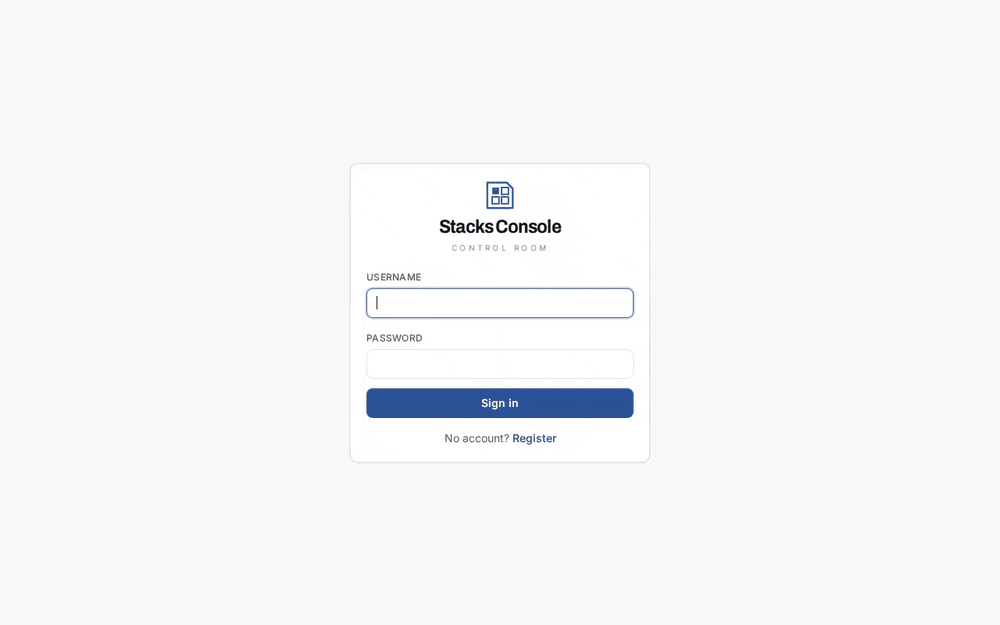

# gameserver-stacks

**Run your own game servers from a web dashboard on one Docker host: add a server in the
browser, and it downloads, configures, starts, backs up and restores it for you.**



> **Status:** early — first release v0.1.0. Seven games, each run end to end through the dashboard on a
> test host; see [Known limitations](#known-limitations).
> **Languages:** the dashboard speaks English and German; the docs are English.

- **Add a server in the browser.** Pick the game, check the suggested values, press create. The
  dashboard pulls the image (with progress), writes the configuration, creates the container
  and starts it. Edit, switch off and remove work the same way.
- **Backups you can restore.** Weekly and on demand. A restore takes a safety backup first,
  replaces the world and checks that the server comes back up. The dashboard's own database is
  dumped every night.
- **Nothing exposed by default.** The dashboard listens on `127.0.0.1`, remote consoles are
  never published, and game passwords entered in the UI are stored encrypted. HTTPS with
  automatic certificates is one compose profile away.
- **Players can actually get in.** Port conflict checks, a bind address per server, a
  reachability panel with firewall commands, and an optional helper that opens the game ports
  in Docker's firewall chain.
- **No dashboard required.** Every game is also a small, readable Docker Compose block that runs
  on its own ([below](#game-blocks)).

## Quick start

Requirements: Linux with Docker Engine and the Compose plugin 2.24 or newer, and `git`. Nothing
needs `sudo` if your user may run `docker`.

```bash
git clone https://github.com/Juice-de-Orange/gameserver-stacks.git
cd gameserver-stacks/dashboard
./setup                # writes .env with fresh secrets, creates ./data/servers
docker compose up -d
```

`./setup` prints the address and a one-time password for `admin`. Open
<http://127.0.0.1:8080> on the host (from elsewhere: `ssh -L 8080:127.0.0.1:8080
you@your-server`), sign in, set your own password, choose your games and add the first server.
`docker compose up -d` pulls the prebuilt images from GHCR (amd64 and arm64); if the pull fails,
Compose builds them from the checkout instead. With the release images pulled and
`postgres:16-alpine` and the socket proxy already cached, the sign-in page was up **about half a
minute** after `git clone` (measured 2026-10-13 in two runs: 32 s and 31 s).
If your uid is not 1000, `./setup` says so and the start is `docker compose up -d --build`.
`./setup --help` lists the options: another data directory, the games, the port.

The [dashboard README](dashboard/README.md) explains every step, the configuration, updates and
a second installation on the same host. [Operations](dashboard/docs/operations.md) covers HTTPS
(bundled, or Caddy, nginx, Traefik, Cloudflare Tunnel), the firewall, backups and restore, logs
and host reboots. The [security model](dashboard/docs/security.md) says what an admin can do
(short version: an admin is root on the host).

## How it compares

Checked against the projects' own sites, docs and release pages on 2026-10-12.

| | Stacks Console (this) | [Pterodactyl](https://pterodactyl.io/) | [Pelican](https://pelican.dev/) | [AMP](https://cubecoders.com/AMP) | [Crafty Controller](https://craftycontrol.com/) | [LinuxGSM](https://linuxgsm.com/) |
|---|---|---|---|---|---|---|
| Licence, price | MIT, free | MIT, free | AGPL-3.0, free | proprietary; personal licences are a one-time payment (from £7.50), commercial use needs a subscription | GPL-3.0, free | MIT, free |
| Interface | web UI | web UI | web UI | web UI | web UI | command line |
| Games | 7, each with a game-specific driver (console, saves, mods, versions) | hundreds through community "eggs" | the same eggs, Pelican format | "well over 200" templates | Minecraft only (Java and Bedrock) | about 140 |
| Game servers run as | Docker containers | Docker containers | Docker containers | processes, or Docker containers | processes | processes in tmux |
| Hosts | one | many (Wings daemon per node) | many (Wings per node) | several, from the Professional licence | one | one per install |
| What the host needs | Docker with Compose; everything else in containers | PHP, MySQL or MariaDB, Redis, a web server; Docker on the nodes | PHP, a database (SQLite possible), a web server; Docker on the nodes | its installer (Linux or Windows) | Python and Java, or its Docker image | bash, tmux and per-game packages |
| Latest release | none yet | 1.15.1 (2026-08-14) | 1.0.0-rc.1 (2026-10-10) | 2.8.0 (2026-06); AMP 3 in beta | 4.11.0 (2026-09-16) | 26.3.0 (2026-10-10) |

When to choose which, honestly:

- **Pterodactyl or Pelican** if you run many games or many machines, or host for other people:
  they have the largest template catalogues and multi-node support, at the cost of a PHP stack to
  run. Pelican is the newer fork with roles and plugins, and is at its first release candidate.
- **AMP** if you want a polished commercial panel that also runs on Windows and installs without
  a web server or database, and a one-time licence fee with instance limits is fine.
- **Crafty Controller** if you only run Minecraft.
- **LinuxGSM** if you live on the shell and want the widest game list without any web UI.
- **Stacks Console** if you run a handful of the seven games on one Docker host and want more
  than start and stop: game-aware backups and restores, version changes with a boot check, mod
  handling, a safe console for helpers, player statistics, and a reachability check. Everything
  is one Compose project; there is no PHP stack, no daemon and no agent to install.

Built with AI assistance.

## Known limitations

- **All seven games have run end to end through the UI** on a test host (create, start,
  console where the game has one, backup and restore, edit, remove). A real game client has
  joined only Minecraft so far.
- **Vintage Story's console** needs the third-party "Vintage RCON" server mod.
- **Arma Reforger runs as root** in its container, so its files belong to root; the dashboard
  deletes them through a helper container.
- **One host**, one API process; no remote nodes.
- **An admin is root on the host** (through the Docker socket proxy). Grant the role accordingly.
- **The check from outside** in the reachability panel is IPv4 only.
- **The firewall helper** is tested with nf_tables iptables in a network namespace only; legacy
  iptables is untested.
- The steamcmd helper (Project Zomboid workshop mods) and the Vintage Story runner are amd64
  only; the dashboard and firewall helper images are built for amd64 and arm64.

More detail: [dashboard README](dashboard/README.md#known-limitations).

## Game blocks

Each block in [`games/`](games) is self-contained: copy the directory to any Docker host, fill in
`.env`, run `docker compose up -d`. The [`stack`](stack) helper adds the same commands for every
game — start, logs, console, backup, restore, clean shutdown — and CI checks every block on each
change. The dashboard's presets come from these blocks, but the two are independent: the
dashboard does not take over a container started from a block.

The READMEs are the main value: they record what it takes to run each server for real — which
ports matter, where the RCON password actually comes from, which config file the server rewrites at
start, what belongs into a backup, and which mistakes cost a world.

### Games

| Game | Block | Image (licence) | Default ports | Console |
|---|---|---|---|---|
| Arma Reforger | [`arma-reforger`](games/arma-reforger) | [`ghcr.io/acemod/arma-reforger`](https://github.com/acemod/docker-reforger) (MIT) | 2001/udp, 17777/udp | BattlEye RCON, internal |
| Avorion | [`avorion`](games/avorion) | [`rfvgyhn/avorion`](https://github.com/rfvgyhn/docker-avorion) (MIT) | 27000/tcp+udp, 27003, 27020, 27021/udp | Source RCON, internal |
| Factorio 2.0 | [`factorio`](games/factorio) | [`factoriotools/factorio`](https://github.com/factoriotools/factorio-docker) (MIT) | 34197/udp | Source RCON, internal |
| Minecraft (Paper) | [`minecraft`](games/minecraft) | [`itzg/minecraft-server`](https://github.com/itzg/docker-minecraft-server) (Apache-2.0) | 25565/tcp (+ 24454/udp voice chat, optional) | Source RCON, internal |
| Project Zomboid (B42) | [`project-zomboid`](games/project-zomboid) | [`danixu86/project-zomboid-dedicated-server`](https://github.com/Danixu/project-zomboid-server-docker) (GPL-3.0) | 16261/udp, 16262/udp | Source RCON, internal |
| Valheim | [`valheim`](games/valheim) | [`ghcr.io/community-valheim-tools/valheim-server`](https://github.com/community-valheim-tools/valheim-server-docker) (Apache-2.0) | 2456–2458/udp | none (in-game admin console only) |
| Vintage Story | [`vintage-story`](games/vintage-story) | [`devidian/vintagestory`](https://github.com/Devidian/docker-vintagestory) (no licence file upstream) | 42420/tcp+udp | optional RCON mod, internal |

Every image is referenced by name only; no script from any image is copied into this repository.

### Quick start with a block

Requirements: Linux with Docker Engine and the Compose plugin (`docker compose version` ≥ 2.20).

```bash
git clone https://github.com/Juice-de-Orange/gameserver-stacks.git
cd gameserver-stacks/games/valheim
cp .env.example .env
$EDITOR .env                 # set the required values (empty in the example)
docker compose up -d
docker compose logs -f       # the block's README says which line means "ready"
```

Or with the helper, from the repository root:

```bash
./stack list                 # games and their state
./stack up valheim
./stack logs valheim -f
./stack backup valheim       # stop → archive → start
./stack rcon factorio /players
```

`./stack help` lists every command.

### What every block promises

| | |
|---|---|
| **Pinned image** | An explicit tag through a `*_TAG` variable; never `latest`. Updates are a deliberate edit. |
| **No default passwords** | Required secrets have no fallback — Compose refuses to start until you set them. |
| **Console stays private** | RCON/admin ports are never published; `./stack rcon` reaches them from a throwaway container on the block's network. |
| **Your data is plain files** | Worlds and configs live in `games/<game>/data/`, ignored by git. |
| **Consistent backups** | `backup.list` names what belongs together; `./stack backup` stops the server for the copy. |
| **Upstream defaults** | Ports are the game's defaults and can be changed in `.env`. |

The contract is written down in [docs/CONVENTIONS.md](docs/CONVENTIONS.md).

### Running blocks for longer

[docs/OPERATIONS.md](docs/OPERATIONS.md) covers what matters after the first evening: why Docker's
published ports bypass UFW and how to allow-list them in the `DOCKER-USER` chain, stopping the
servers cleanly before a host reboot (with a systemd unit in [`examples/`](examples)), scheduling
and pruning backups, and updating without losing a world.

## Licences

The compose files, scripts, the dashboard and the documentation in this repository are
MIT-licensed ([LICENSE](LICENSE)). The game images are third-party projects with their own
licences, linked from each block. The game server software itself is proprietary; the images download it at runtime
from Steam or the vendor. Nothing of any game is contained in this repository. Some games require
you to accept their terms (for example Minecraft's EULA) — the blocks never do that for you, and
the dashboard asks you to accept them per server.

## Contributing

Corrections from people who run these servers are the most valuable contribution. See
[CONTRIBUTING.md](CONTRIBUTING.md); security reports go through [SECURITY.md](SECURITY.md).
